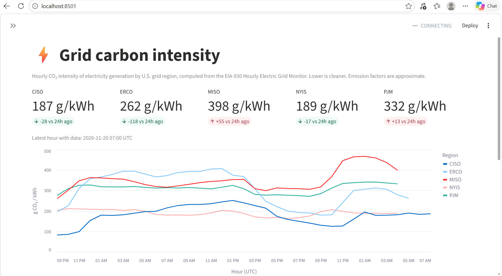
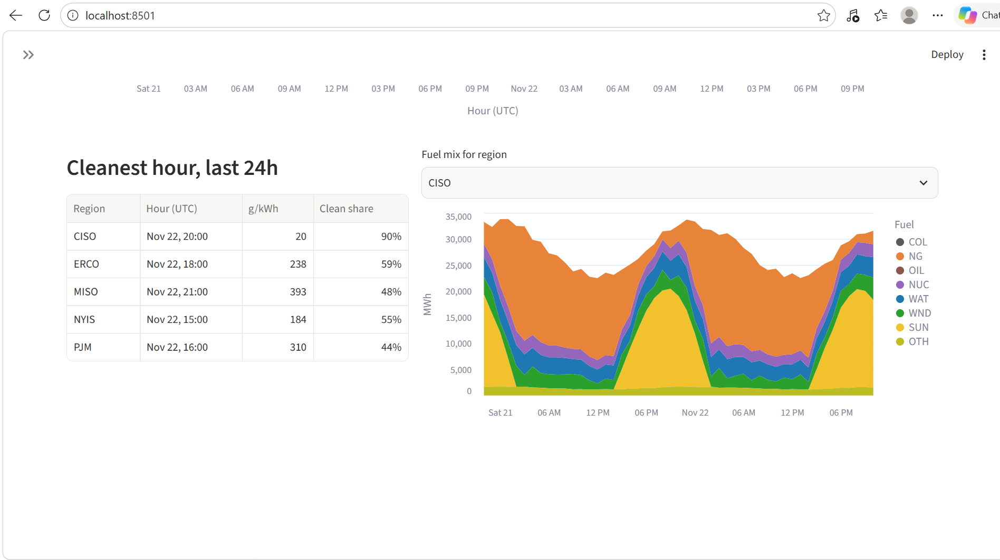

# ⚡ grid-carbon-stream

A streaming data pipeline that tracks how carbon-intensive U.S. electricity is, hour by hour, by grid region, using public data from the EIA-930 Hourly Electric Grid Monitor.

```
EIA Open Data API ──► Python producer ──► Redpanda (Kafka API) ──► Python consumer ──► DuckDB ──► Streamlit
   (hourly, free)     polls + keys         2 topics, 3 partitions   at-least-once,       upserts,     live
                      each event                                    idempotent writes    intensity    dashboard
```

**Live dashboard:** hourly carbon intensity by grid region, cleanest hour, and fuel mix

**Live dashboard:** hourly carbon intensity by grid region, cleanest hour, and fuel mix



**Question it answers:** *How clean is the grid in Texas, PJM, MISO, California and New York right now, and when was the cleanest hour today?*

## Quick start

Prereqs: Docker Desktop, Python 3.10+.

```bash
python -m venv .venv && source .venv/bin/activate      # Windows: .venv\Scripts\activate
pip install -r requirements.txt && pip install -e .
cp .env.example .env                                     # add your EIA key here

docker compose up -d                                     # Redpanda on :19092, Console on :8080
```

Open three terminals (activate the venv in each):

| Terminal | Command | What it does |
|---|---|---|
| 1 | `python -m gridcarbon.consumer` | Reads both topics, writes DuckDB, computes intensity |
| 2 | `python -m gridcarbon.producer --mock` | Synthetic data: 48h backfill, then one new hour every 5s |
| 3 | `streamlit run app/dashboard.py` | Dashboard at http://localhost:8501 |

When your EIA key is in `.env`, stop the mock producer and run `python -m gridcarbon.producer` for real data. It polls every 15 minutes and re-requests the last 48 hours each time, because EIA data arrives late and gets revised. Set `DUCKDB_PATH` to a fresh file first if you don't want mock and real rows mixed together.

**Just want to see the dashboard?** Run `python -m gridcarbon.demo` (loads mock data straight into DuckDB, no Docker), then the Streamlit command.

Get a free EIA key at https://www.eia.gov/opendata/ (it's emailed to you).

## How carbon intensity is calculated

```
intensity (g CO₂/kWh) = Σ (MWh_fuel × kg CO₂/MWh_fuel) / Σ MWh_fuel
```

Emission factors live in `src/gridcarbon/config.py` (coal 1000, gas 410, oil 850, all others 0 kg/MWh). **These are approximate starting values.** Replacing them with EPA eGRID factors is listed under next steps.

## Design decisions 

| Decision | Why |
|---|---|
| **Idempotent upserts** keyed on `(region, hour, fuel)` | EIA revises recent hours, and the producer re-sends a 48h window on every poll. Duplicates and revisions overwrite instead of piling up. |
| **Commit Kafka offsets after the DuckDB transaction** | At-least-once delivery plus idempotent writes gives effectively-once results. A crash mid-batch just replays it. |
| **Event key = `region\|hour\|fuel`** | The same logical row always lands on the same partition, so revisions stay in order. |
| **Incremental recompute** | Only (region, hour) pairs touched by a batch are recalculated, not the whole table. |
| **Negative generation excluded** | Battery and pumped-storage *charging* shows up as negative MWh. It's consumption, not generation. |
| **Unknown fuel codes flagged, not dropped** | If EIA adds a fuel code with no emission factor, it's recorded in `unknown_fuels` and shown on the dashboard. |
| **Short-lived DuckDB connections** | DuckDB allows one writer process. The consumer opens per batch, so the dashboard can read in between. |
| **Malformed messages counted and skipped** | One bad message shouldn't stop the pipeline. (Next step: route them to a dead-letter topic.) |

## Project layout

```
src/gridcarbon/
  config.py      settings, topics, emission factors
  eia.py         EIA API v2 client: pagination, retries, normalization
  mock.py        synthetic EIA-shaped data
  producer.py    EIA/mock -> Redpanda
  consumer.py    Redpanda -> DuckDB
  storage.py     schema, upserts, intensity SQL
  demo.py        load mock data without Kafka
app/dashboard.py Streamlit dashboard
tests/           pytest: API parsing, pagination, carbon math, idempotency, end to end
```

Run tests with `pytest`.

## Roadmap

- [x] **Day 1:** producer → Redpanda → consumer → DuckDB → dashboard
- [ ] Replace emission factors with EPA eGRID; add NOAA weather
- [ ] Dead-letter topic + schema validation (Pydantic or JSON Schema)
- [ ] dbt models on top of DuckDB (staging → marts), dbt tests
- [ ] Dagster orchestration + asset lineage
- [ ] Apache Iceberg tables for storage
- [ ] Forecast next-24h intensity ("best time to charge an EV")
- [ ] Agent layer (Project #4): detect and fix injected pipeline failures

## Data source

U.S. Energy Information Administration, EIA-930 Hourly Electric Grid Monitor, via the EIA Open Data API v2 (`electricity/rto/fuel-type-data`, `electricity/rto/region-data`). Public domain U.S. government data.
